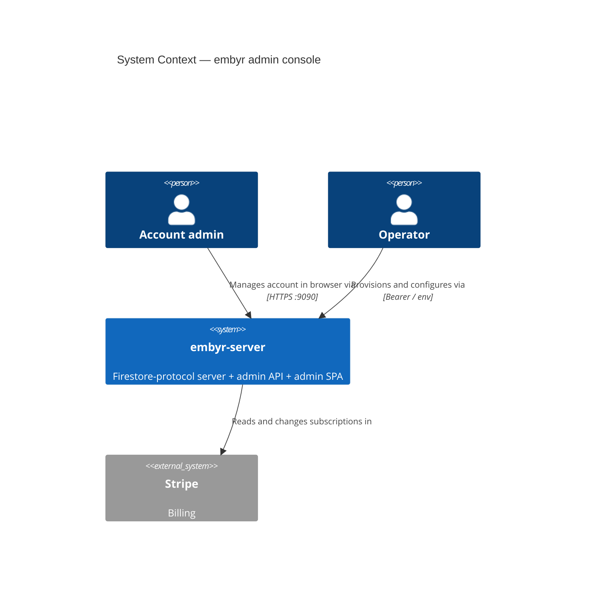
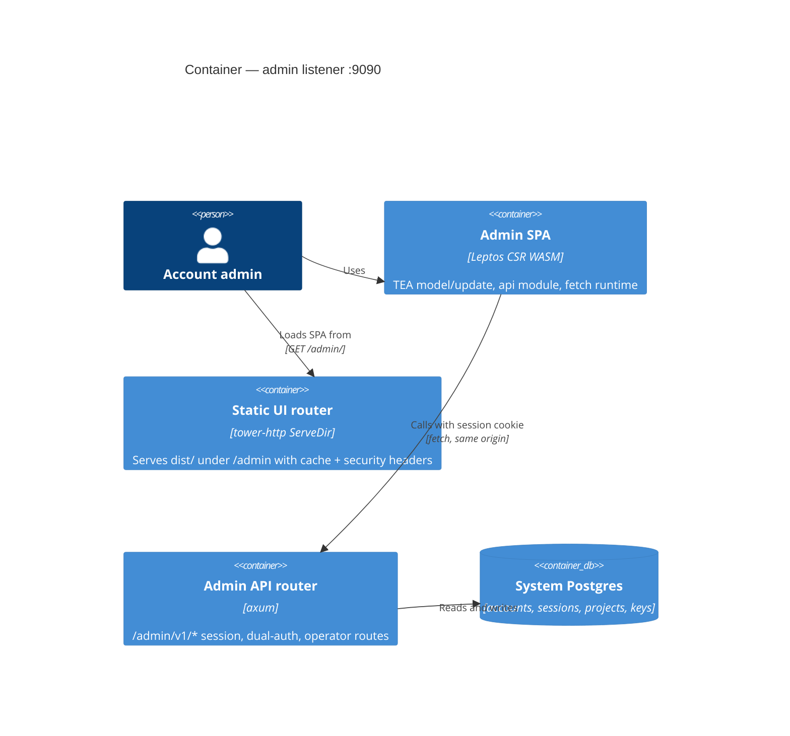

# admin-ui-api-wiring — Feature Delta (combined DISCUSS + DESIGN)

Lean nWave: one doc, self-reviewed. ADR: `docs/product/architecture/adr-082-admin-ui-api-wiring.md` (supersedes ADR-007).
Decided by the user, not re-litigated: every admin-UI screen talks to the real admin API in one pass; `embyr-server`
serves the built SPA on the admin listener (:9090), same origin; mock data survives only as test fixtures.

**Revision 2 (five further user decisions).** Capabilities the API lacked are now built as separate features and wired here *once they land*
(§4 "wired once feature X lands"; delivery order in §9): `dsn-single-store` (ADR-083), `hourly-metrics-rollup` (ADR-084),
`account-bootstrap-and-invitations`, `account-deletion`, `admin-oidc-sso`. Security fixes #58 (callback disabled), #59 (`patch_project`
role gate, status validation, cache eviction) and #60's role cap are being done in a separate PR and are treated as done server-side;
their acceptance criteria below stay as dependencies.

## 1. Problem

`crates/embyr-admin-ui` (Leptos CSR, TEA) is a demo: `AppModel::from_mock()`, fake sign-in, zero HTTP calls, and
`views/` read hardcoded `data::display_stats(idx)`. Nothing in `embyr-server` serves `dist/`. Meanwhile `:9090`
already exposes 40+ session-authed routes under `/admin/v1`. An account admin cannot use the console for anything real.

## 2. User stories and acceptance criteria

**US-AUW-01 — Operator serves the console from the admin listener.**
- AC-AUW-01: Given `EMBYR_ADMIN_UI_DIR` points at a trunk `dist/`, When `GET /admin/`, Then 200 `text/html` containing the WASM bootstrap script.
- AC-AUW-02: Given the same, When `GET /admin/<hashed>.wasm|.js|.css`, Then 200 with `Cache-Control: public, max-age=31536000, immutable`.
- AC-AUW-03: Given the same, When `GET /admin/`, Then `Cache-Control: no-cache` plus CSP, `X-Content-Type-Options: nosniff`, `Referrer-Policy: no-referrer`, `X-Frame-Options: DENY`.
- AC-AUW-04: Given the UI is mounted, When any existing `/admin/v1/*` route is called, Then its behaviour is unchanged (API routes win over static files; unknown `/admin/v1/x` is 404, never HTML).
- AC-AUW-05: Given `EMBYR_ADMIN_UI_DIR` is unset, When the server starts, Then it starts API-only and `GET /admin/` is 404.
- AC-AUW-06: Given `EMBYR_ADMIN_UI_DIR` is set but the dir, `index.html`, or any asset `index.html` references is missing, When the server starts, Then it refuses to start with a named error.

**US-AUW-02 — Admin signs in and out for real.**
- AC-AUW-07: Given valid email + password + TOTP, When the form is submitted, Then `POST /auth/signin` is sent and on 200 the shell is shown with the user's display name and role.
- AC-AUW-08: Given a 401 from signin, Then the server's message is shown and the user stays on sign-in; no client-side attempt counter exists.
- AC-AUW-09: Given a 429 without `retry-after-ms`, Then the form shows "account locked"; Given a 429 with it, Then "too many attempts, retry in N s".
- AC-AUW-10: Given a recovery code is entered instead of a TOTP code, Then the request carries `recovery_code` and no `totp_code`.
- AC-AUW-11: Given a valid session cookie, When the page is reloaded, Then `GET /auth/session` restores the signed-in shell without showing sign-in.
- AC-AUW-12: Given any non-auth call returns 401, Then all account data is dropped from the model and sign-in is shown with "session expired".
- AC-AUW-13: Given Sign out is clicked, Then `POST /auth/signout` is sent and the model is reset to its empty default.
- AC-AUW-14: Given the server is unreachable at boot, Then a "cannot reach server" state with Retry is shown, not the sign-in form.

**US-AUW-03 — Every screen shows real data.**
- AC-AUW-15: Given a signed-in user, When any section is opened, Then the calls listed in §3 for that section are issued and their results render.
- AC-AUW-16: Given a call is in flight, Then the affected region shows a loading state and its action buttons are disabled.
- AC-AUW-17: Given a load fails (non-401), Then a toast names the failure, previously loaded data stays, and Refresh retries.
- AC-AUW-18: Given the shipped UI source (`app.rs`, `views/`, `components/`), Then it contains no reference to `from_mock`, `data::mock` or `display_stats`.

**US-AUW-04 — Mutations are confirmed by the server.**
- AC-AUW-19: Given a mutation is submitted, Then the model changes only after a 2xx; on failure the model is unchanged and a toast explains (403 → "your role does not allow this").
- AC-AUW-20: Given an SDK key, admin key or database is created, Then the plaintext secret is shown exactly once in a reveal modal and is absent from the model after it closes.
- AC-AUW-21: Given a Viewer, Then mutating controls are disabled; Given a non-Owner, Then the OIDC section is hidden.
- AC-AUW-22: Given a pending invitation row, Then its role selector and Remove button are disabled.

**US-AUW-05 — No fake elements remain.** AC-AUW-23: Given §4, Then every element marked DROP is absent from the built UI, and every element marked "wired once feature X lands" is either wired to that feature's endpoint or hidden until X is delivered (never shown with fake data).
- AC-AUW-28: Given the SSO buttons are hidden (G-13), Then the sign-in view contains no "Continue with Google/GitHub" until `admin-oidc-sso` lands.
- AC-AUW-29: Given `dsn-single-store` has landed, When an Owner/Admin saves a DSN or switches backend mode, Then `PUT /connection` is called, a probe failure is shown verbatim as the server's error and the displayed summary is unchanged.
- AC-AUW-30: Given `hourly-metrics-rollup` has landed, Then latency tiles show `null` percentiles as "—", never `0 ms`.

**Server additions in this feature** (each has its own AC in §6): AC-AUW-24 `GET /auth/session`; AC-AUW-25 session-authed project create sets
`account_id` (provision body per `dsn-single-store`); AC-AUW-26 session-authed project delete is account-scoped; AC-AUW-27 *(implemented by
the security PR for #59, kept as a dependency)* `PATCH /projects/:id` rejects Viewer (403), rejects status outside `active|suspended` (422),
evicts the credential cache on status change, and returns 409 on `active` while the subscription is not `active`.

## 3. Screen-by-screen endpoint map

All paths are under `/admin/v1`. "→" = response fields used. Result `Msg`s in *italics* already exist and keep their current pure semantics
("apply a server-confirmed change"); **bold** ones are new. Every row is triggered by `Msg::Request(ApiCall::…)` (§5.2).

| View / trigger | Call | Request → response | Model mapping |
|---|---|---|---|
| App boot | `GET /auth/session` (new) | → `account_id, account_name, user_id, email, display_name, role` | **`SessionEstablished(CurrentUser)`** → `authed`, `current_user` |
| Auth: Continue | `POST /auth/signin` | `email, password, totp_code \| recovery_code` → `account_id, display_name, role` + cookie | then `GET /auth/session`; failure → **`SignInFailed`** |
| Sidebar: Sign out | `POST /auth/signout` | → 204 | *`SignOut`* (now resets whole model) |
| Dashboard, Databases: open / Refresh | `GET /projects` | → `[id, name?, status, backend_mode, logging_enabled, created_at]` | *`SetDatabases`* → `Database{id: DbId(String), name ?? id, …}` |
| Dashboard cards, KPI row *(after hourly-metrics-rollup)* | `GET /metrics/summary` | → per project `reads_today, writes_today, deletes_today, p95_read_ms?, p95_write_ms?` | **`SetMetricsSummary`** → `db_metrics` map |
| DB detail Overview *(after hourly-metrics-rollup)* | `GET /projects/:id/metrics?window=24h` | → `reads_today…`, `latency.{read,write}.{p50_ms,p95_ms,p99_ms,samples}`, `series[hour,reads,writes,deletes,errors]` | **`SetDbMetrics(DbId, DbMetrics)`** |
| Create database modal | `POST /projects` (extended, ADR-083) | `project_id, name, backend_mode, dsn \| agent_endpoint + 3 PEMs` → `project_id, api_key` | *`DatabaseCreated`* + **`SecretRevealed`** |
| Connections tab *(after dsn-single-store)* | `GET /projects/:id/connection` | → `backend_mode, summary{host,port,database,tls} \| {endpoint,cert_expires_at} \| {reference}` | **`SetConnection(DbId, ConnectionSummary)`** |
| Connections: Save DSN / agent config / switch mode *(after dsn-single-store)* | `PUT /projects/:id/connection` | `backend_mode, dsn \| agent_endpoint + PEMs` → `{backend_mode, probe}`; 400 `{error}` on probe failure | **`SetConnection`** (via reload) |
| DB detail: open | `GET /projects/:id` | → above + `log_retention_days` | **`DatabaseLoaded(Database)`** |
| DB detail: Suspend / Activate | `PATCH /projects/:id` | `status: "suspended" \| "active"` → detail | *`PatchDb(id, Suspended(b))`* |
| Overview: logging toggle, retention; Logs: Enable | `PATCH /projects/:id` | `logging_enabled, log_retention_days` → detail | *`PatchDb(id, LoggingEnabled(..))`* |
| DB detail: Delete | `DELETE /projects/:id` (extended) | → 200 | *`DeleteDatabase`* + navigate to Databases |
| Keys tab: open | `GET /projects/:id/sdk_keys?active=true` | → `[id, name, prefix, created_at]` | **`SetSdkKeys(DbId, Vec<SdkKey>)`** |
| Keys tab: create | `POST /projects/:id/sdk_keys` | `name` (1–64) → `id, name, key, prefix, created_at` | *`SdkKeyCreated`* + **`SecretRevealed`** |
| Keys tab: revoke | `DELETE /projects/:id/sdk_keys/:key_id` | → 204 | *`RevokeSdkKey`* |
| Logs tab: open / filter / Load more | `GET /projects/:id/query_logs?op=&after=` | → `total, entries[id, op, collection_path?, latency_ms?, status, error_code?, created_at]` | **`SetQueryLogs{db, page, append}`** → `query_logs` map |
| Identities: open | `GET /members` | → `[id, email, display_name?, role, auth_method, mfa_enabled, joined_at?]` | **`SetMembers`**; `pending = auth_method == "pending"` |
| Members: invite | `POST /members/invite` | `email, role` → 202 `invitation_id, email, role, expires_at` (+ `invite_token` after account-bootstrap-and-invitations) | *`MemberInvited`* (pending) + copy-link reveal |
| Members: revoke pending *(after account-bootstrap-and-invitations)* | `DELETE /members/invitations/:id` | → 204 | **`InvitationRevoked`** |
| Invite link `/admin/?invite=<token>` *(after account-bootstrap-and-invitations)* | `POST /auth/invitations/accept`, then `POST /auth/invitations/confirm` | `token, display_name, password` → `otpauth_uri, totp_secret`; `token, totp_code` → `recovery_codes` | **`EnrolmentStep`** (pre-auth screen state, not `AppModel.authed`) |
| Danger Zone: Delete account *(after account-deletion)* | `DELETE /account` | `password, totp_code \| recovery_code, confirm_account_name` → 202 `purge_after` | **`SessionExpired`**-style reset + "scheduled for deletion" notice |
| Members: role select | `PATCH /members/:id/role` | `role` → `{ok}` | *`SetMemberRole`* |
| Members: Remove | `DELETE /members/:id` | → 204 (409 `{message}` last Owner) | *`RemoveMember`* |
| Identities, API Keys: open | `GET /service_accounts` | → `[id, name, description?, role, created_at]` | **`SetServiceAccounts`** |
| Service accounts: create | `POST /service_accounts` | `name, description?, role` → 201 summary | *`ServiceAccountCreated`* |
| Service accounts: Delete | `DELETE /service_accounts/:id` | → 204 | *`DeleteServiceAccount`*, then reload admin keys |
| API Keys: open | `GET /admin_keys` | → `[id, name, role, prefix, created_at, last_used_at?, revoked_at?]` | **`SetAdminKeys`** (adds `revoked: bool`) |
| API Keys: create | `POST /admin_keys` | `name, role, service_account_id?` → `id, name, key, prefix, created_at` | *`AdminKeyCreated`* + **`SecretRevealed`** |
| API Keys: Revoke | `DELETE /admin_keys/:id` | → 204 | *`RevokeAdminKey`* (marks revoked) |
| Settings: open (Owner only) | `GET /oidc_providers` | → `[id, issuer, client_id, enabled]` | **`SetOidcProviders`** |
| Settings: add provider | `POST /oidc_providers` | `issuer, client_id, client_secret` → 201 (409 duplicate issuer) | *`OidcProviderAdded`* |
| Settings: toggle | `PATCH /oidc_providers/:id` | `enabled` (explicit target value) → provider | *`ToggleOidc`* |
| Settings: remove | `DELETE /oidc_providers/:id` | → 204 | *`RemoveOidcProvider`* |
| After sign-in (banner, sidebar plan), Billing: open | `GET /billing/subscription` | → `plan, status, stripe_customer_id, current_period_end?, cap_status?[dimension, used, cap, pct]` | *`SetSubscription`* (adds `status`, `cap_status`) |
| Upgrade modal: confirm | `POST /billing/subscription` | `plan: "free" \| "pro"` → same shape | *`SetSubscription`* + *`CloseUpgradeModal`* |
| Billing: Usage tab | `GET /billing?range=month` | → `databases[id, name?, reads, writes, deletes], totals` | **`SetUsage(Vec<UsageTableRow>)`** |

Not mapped on purpose (no screen exists; out of scope): `indexes`, `access_rules*`, `client_identity_credential*`,
`hosted_identity`, `anonymous_identity`, `oauth_providers/google`, operator-only `suspend|activate|run-metering|/metrics`, operator
`POST /accounts` (an operator/CLI action, no console screen), and SSO (`auth/oidc/start|callback`: browser redirects, wired in slice 16).

## 4. Gap list

Recommendation key: **ADD/EXTEND** = server change in this feature · **UI** = change the UI · **DROP** = remove the UI element.

Cross-cutting
- **G-01** No production code path creates an account, user, membership or TOTP secret (only test fixtures `INSERT` them); a fresh deployment cannot sign in without hand-written SQL (audit #63). → **Wired once `account-bootstrap-and-invitations` lands** (operator `POST /accounts` creating the account plus an Owner invitation; same enrolment path as invitations). Until then local/dev deployments seed via SQL fixtures. Not a console screen.
- **G-02** No session-authed database creation. Operator `POST /projects` never sets `account_id` or `name`, so nothing it creates appears in any account's `GET /projects`. → **EXTEND**: `POST /projects` becomes dual-auth; a session caller (Owner/Admin) gets `account_id = session.account_id`; body accepts `name`.
- **G-03** `DELETE /projects/:id` is operator-only; the UI's Delete button currently only closes its modal. → **EXTEND**: dual-auth, account-scoped, Owner/Admin.
- **G-04** No "who am I" endpoint: after a reload the SPA cannot tell whether the HttpOnly cookie is valid, nor the role, display name or account name. → **ADD** `GET /admin/v1/auth/session`.
- **G-05** `DbId(Uuid)` vs API project ids, which are operator-chosen strings. → **UI**: `DbId(String)`.
- **G-06** `backend_mode`: API has `direct_pg | agent | aws_secret | gcp_secret`; UI has `DirectPg | AgentMode` (labelled `agent_mode`). → **UI**: add the two variants for display; the create form offers `direct_pg` and `agent` only.
- **G-07** Project `name` is nullable in the API. → **UI**: fall back to the id.
- **G-08** Role strings are exactly `Owner | Admin | Viewer` (DB CHECK); UI forms use lowercase values. → **UI**: map in the api module.
- **G-09** `model.toasts` is never rendered by any view or component, so errors would be invisible. → **UI**: add a toast stack to the shell and the sign-in view.
- **G-10** API errors are mostly bare status codes, with three body shapes (`{message}`, `{error, detail}`, empty). → **UI**: one status→message table in the api module; show server text when present. No API change.
- **G-11** The session cookie is `Secure`: on a plain-HTTP non-localhost admin listener the browser drops it, so sign-in "succeeds" and the next call is 401. → No API change; document "HTTPS or localhost"; **UI** shows a specific hint when the post-signin session check is 401.

Sign-in
- **G-12** No TOTP or recovery-code input; the email and password inputs are not bound to anything. → **UI**: bind them, add a code field and a "use a recovery code" toggle.
- **G-13** "Continue with Google / GitHub": the API has only an OIDC callback (expects `id_token` in the query; audit #58, being disabled), no flow-start endpoint, and GitHub is not OIDC. → **HIDE now; wired once `admin-oidc-sso` lands** as a per-provider "Continue with SSO" started from `/admin/?sso=<provider_id>` (slice 16). The GitHub button is DROP (not OIDC).
- **G-14** Client-side TOTP failure counter (3 → locked) duplicates the server's lockout and resets on reload. → **UI**: remove `totp_failures`, `TotpFailure`, `TotpSuccess`; show the server's message; 429 without `retry-after-ms` ⇒ locked, with ⇒ throttled.
- **G-15** Sign-out clears only `authed`, `nav`, `toasts`. → **UI**: reset the whole model.

Dashboard and DB overview
- **G-16** P50/P95/P99 latency: the API returns a hardcoded `p95_read_ms: 0.0` and no p50/p99. → **Wired once `hourly-metrics-rollup` lands** (real `latency.{read,write}` percentiles, `null` = "—"): latency tiles, per-card P95, latency chart, "Avg P95" KPI. Until then these elements are hidden, not mocked.
- **G-17** Card sparkline and "Operations — last 12 intervals": the API `sparkline` is `reads_today / 24` repeated 24 times (synthetic). → **Wired once `hourly-metrics-rollup` lands** (real `series`, hourly, 24 h or 7 d); the existing SVG chart helpers are fed hourly points instead of 12 intervals. Hidden until then.
- **G-18** Region ("us-east-1"): no such concept in the API. → **DROP**.
- **G-19** Per-database "today" counters need one `GET /projects/:id/metrics` per database. → **Resolved by `hourly-metrics-rollup`**: `GET /metrics/summary` returns every project in one call (dashboard cards). Until it lands the dashboard shows only counts from `GET /projects`.
- **G-20** "Personal", "Pro plan", avatar "Y", notification dot are hardcoded. → **UI**: account name and initial from G-04, plan from the subscription; **DROP** the bell and the Docs button.
- **G-21** Dashboard "New database", "Create database" card and "Refresh" have no handlers. → **UI**: wire them.
- **G-22** "created" shows a mock string. → **UI**: `created_at`.

DB detail
- **G-23** Connection display (fake masked DSN / mock endpoint): the API never returns a DSN or agent endpoint. → **Wired once `dsn-single-store` lands**: `GET /projects/:id/connection` returns host/port/database/tls (or agent endpoint and cert expiry) — never credentials. Until then the card shows only the mode and "stored encrypted".
- **G-24** Edit DSN: `PATCH backend_pg_dsn` writes `backend_pg_dsn_enc`, which request serving never reads (it uses `ecies_encrypted_dsn`), and it does not probe. → **Wired once `dsn-single-store` lands**: `PUT /projects/:id/connection` probes before saving; the edit control is hidden until then.
- **G-25** Edit agent endpoint and "Switch backend mode": no API. → **Wired once `dsn-single-store` lands** (same `PUT /connection`, `direct_pg`↔`agent`, secret-manager modes read-only); hidden until then.
- **G-26** Suspend/Activate: the dedicated routes are operator-only. Session `PATCH {status}` works, but `patch_project` had no role gate (audit #59). → **UI** uses `PATCH`; the server fix is done by the security PR; AC-AUW-27 stays as the dependency.
- **G-27** `GET /projects` lacks `log_retention_days`; UI retention is a 3-value enum, API an integer. → **UI**: load `GET /projects/:id` on open; store days, offer 1/7/30, render other values as "N days".
- **G-28** "Copy database ID" does not copy. → **UI**: clipboard (web-sys `Clipboard` is already enabled).

SDK keys
- **G-29** Create is a placeholder modal ("use the API or CLI"); the API returns the key once. → **UI**: name form + one-time reveal modal.
- **G-30** "Created" column is a hardcoded "—". → **UI**: `created_at`.

Query logs
- **G-31** The table is a static placeholder row. → **UI**: wire it.
- **G-32** "Docs" column: the API has no document count. → **UI**: replace with Status / `error_code`.
- **G-33** Free-text filter: the API only supports exact `op`. → **UI**: client-side filter over the loaded page; fix the placeholder text.
- **G-34** Operation options "reads / writes / deletes" vs stored values `read | write | delete | listen | run_query`. → **UI**: use the API values.
- **G-35** Time-range select, sort buttons, "auto-refreshes every 30 s": no API support, no behaviour. → **DROP**; add Refresh and "Load more" (`after`), show `total`.

Identities
- **G-36** `last_login_at` is always null (no column). → **UI**: replace "Last Login" with "Joined" (`joined_at`).
- **G-37** Invitations: `NoopEmailSender` is hardwired in `main.rs`, and there is no accept endpoint, no TOTP enrolment and no revoke; a pending row's id is an invitation id the role/remove endpoints do not accept. → invite + list wired now (role/remove disabled on pending rows). **Accept/enrol screen, copy-invite-link and revoke are wired once `account-bootstrap-and-invitations` lands** (slice 14); the success toast says email delivery is not configured until a real sender exists.
- **G-38** The server let an Admin invite an Owner (no escalation check on invite; audit #60). → **UI** offers only roles ≤ own; the server cap is in the security PR, email/role validation in `account-bootstrap-and-invitations`.
- **G-39** "New service account" is disabled although the API exists (requires `role`). → **UI**: create modal (name, description, role).

Admin keys
- **G-40** Create requires `role` (optional `service_account_id`); the UI sends neither, hardcodes Viewer and a fake prefix. → **UI**: role select (≤ own role), service-account select, reveal modal.
- **G-41** The list includes revoked keys and omits member / service-account ids. → **UI**: badge revoked rows and hide their Revoke button; leave the two link fields `None`.

Settings
- **G-42** OIDC list is Owner-only (403) while the UI intends a read-only list for others; `is_owner` is inferred from "some Owner exists". → **UI**: hide the section for non-Owners; role from the session.
- **G-43** Adding a provider requires `client_secret`; the form has no such field. → **UI**: add a password field.
- **G-44** Remove provider: API and `Msg` exist, no button. → **UI**: add it.
- **G-45** Transfer ownership / Delete account: no endpoints. → **Delete account: wired once `account-deletion` lands** (Owner-only modal: account name, password, TOTP; hidden until then). **Transfer ownership: DROP** as a dedicated button — promote another member to Owner then demote yourself in Members (both already allowed by `check_rbac`).

Billing
- **G-46** `card` is always null and there is no card-capture endpoint. → **DROP** the Add/Update button, the `CardModal` trigger and the past-due CTA; show the Stripe customer id only.
- **G-47** Invoices: no endpoint. → **DROP** the tab.
- **G-48** Suspension and cap status are derived locally from mock usage ×30 against UI constants; the server has authoritative `status` and `cap_status`. → **UI**: derive `effective_status()` and the cap bars from the server values.
- **G-49** Usage tab: `storage_gb` has no source (`log_storage_bytes` is a literal 0) and counters are ×30 projections. → **DROP** the Storage column; show month-to-date sums from `/billing?range=month`.
- **G-50** Hardcoded `$49` base price and free caps. → **DROP** the price; included volumes come from `cap_status[].cap`.
- **G-51** The Upgrade modal has no confirm action. → **UI**: add confirm → `POST /billing/subscription`.
- **G-52** The first `GET /billing/subscription` calls Stripe; without a Stripe key it returns 502. → **UI**: "Billing is not configured on this server" state; no banner.

Server findings noticed while reading, now tracked in the audit (#58–63) and handled outside this feature: **F-1 = #58** `oidc_callback`
(callback disabled by the security PR; replaced by `admin-oidc-sso`). **F-2 = #60** `invite_member` role cap (security PR) and
email/role validation (`account-bootstrap-and-invitations`).

**Items that remain DROP** (no server capability planned): region (G-18), notification bell and Docs button (G-20), sort buttons and
time-range select in query logs (G-35), "Docs" column (G-32, replaced by Status), last-login column (G-36, replaced by Joined),
dedicated Transfer-ownership button (G-45), GitHub sign-in button (G-13), card capture / Add-Update card button and past-due CTA (G-46),
invoices tab (G-47), storage column (G-49), plan price (G-50). Nothing found in the code changes these: `card` is always `null`, there is
no invoices route, `log_storage_bytes` is a literal 0.

## 5. Design

### 5.1 Context and containers

### 5.2 Client: effects in TEA, api module, fetch runtime

- **`update` stays pure and gains a return value**: `update(&mut AppModel, Msg) -> Vec<Effect>`; `Effect::Http(ApiCall)` is plain data.
  Existing call sites that ignore the result keep compiling, so existing state tests stay valid.
- **Intent vs result.** One new intent carrier `Msg::Request(ApiCall)`: `update` records the call as pending and returns the effect.
  Existing mutating `Msg`s (`DeleteDatabase`, `RevokeSdkKey`, `SetMemberRole`, `*Created`, `Set*`) keep their semantics and become the
  *result* messages applied after a 2xx. No optimistic updates. Navigation is also pure: `NavigateTo(section)` returns that section's load effects.
- **`src/api.rs` (host-compiled, no browser types)** is the only place that knows routes and JSON field names:
  `ApiCall` (one variant per row of §3), `to_request(&ApiCall) -> HttpRequest {method, path, body}`,
  `decode(&ApiCall, HttpResponse {status, retry_after_ms, body}) -> Vec<Msg>`, private serde DTOs converted into `model.rs` types,
  and `ApiError` (`thiserror`): `Unauthorized, Forbidden, NotFound, Conflict(msg), Invalid(msg), Throttled{retry_after_ms}, Upstream, Server(status), Network(msg), Decode(msg)`.
  Failures decode to `Msg::ApiFailed{call, error}`.
- **Fetch runtime (`csr` only, in `app.rs`)**: `dispatch` runs `update`, then for each effect spawns a local task that performs the
  request with `web-sys` fetch (same origin, so the cookie is sent by default; `Content-Type: application/json`), calls `decode`, and dispatches the results.
- **Transport choice**: `web-sys` + `wasm-bindgen` + `js-sys` are already dependencies; add four `web-sys` features
  (`Request`, `RequestInit`, `Response`, `Headers`) and `serde_json` (workspace). `reqwest` is listed only under `[dev-dependencies]`
  for host tests — not usable in the WASM build as configured, and not worth its weight for one ~40-line transport function.
- **Loading and errors**: `model.pending` (set of in-flight call kinds) drives disabled buttons and per-region loading; errors become toasts
  (new `ToastStack`, G-09); loaded data is kept on failure. Boot uses `booting: bool` so sign-in does not flash before the session check.
- **Session**: boot → `GET /auth/session`; sign-in → `POST /auth/signin` then the session call (also proves the cookie was accepted, G-11);
  `ApiFailed{Unauthorized}` on any call other than sign-in/session → `Msg::SessionExpired` → model reset; sign-out resets the model after the 204.
- **Sign-in failures** (`SignInFailed`): 401 → show server `message` ("Invalid credentials" / "Invalid or expired code");
  429 + `retry-after-ms` → per-IP throttle; 429 without → account locked 15 min (`account_locked = true`); the server owns the counter.
- **Secrets**: password, `client_secret`, DSN and PEMs travel only inside an `ApiCall` whose `Debug` redacts them and are never stored in `AppModel`.
  One-time keys live in `model.revealed_secret: Option<RevealedSecret>` and are cleared on close, navigation and sign-out.

### 5.3 Serving the SPA from :9090

- **ServeDir from a configured path**, not compile-time embedding (ADR-082). New optional `EMBYR_ADMIN_UI_DIR` in `ServerConfig`.
  Unset → API-only (today's behaviour; every existing test server is untouched). Set → `main.rs` merges a static router onto the
  admin app exactly as it already merges `healthz_app`; `build_admin_router`'s signature does not change.
- `tower-http` is already a dependency of `embyr-server` (`cors`); enable its `fs` and `set-header` features. No new crate.
- **Routing**: static service nested at `/admin` (Trunk's `public_url` is already `/admin/`). `/admin/v1/*` routes are explicit and take
  precedence. **No index.html fallback**: the SPA has no URL router (navigation is in-memory, ADR-005), so the only document URL is
  `/admin/` (the OIDC callback's `/admin/?error=…` redirect also lands there); a fallback would turn API typos into `200 text/html`.
  Add the fallback when `leptos_router` arrives.
- **Cache**: hashed assets `public, max-age=31536000, immutable`; `text/html` `no-cache`; no cache header on non-200s.
  No compression yet (admin console, bundle gate < 5 MB) — add `tower-http` compression if load time is measured as a problem.
- **Security headers on static responses**: `X-Content-Type-Options: nosniff`, `Referrer-Policy: no-referrer`, `X-Frame-Options: DENY`, and
  `Content-Security-Policy: default-src 'self'; script-src 'self' 'sha256-<bootstrap>' 'wasm-unsafe-eval'; style-src 'self' 'unsafe-inline'; connect-src 'self'; img-src 'self' data:; frame-ancestors 'none'; base-uri 'self'; form-action 'self'`.
  Trunk emits one inline module bootstrap whose content changes per build, so its hash is computed once at startup from `index.html`
  (`sha2` is a workspace dependency). `style-src 'unsafe-inline'` is required by the views' `style="…"` attributes. The four inline
  `onmouseenter/onmouseleave` handlers in `dashboard.rs` and `db_detail/mod.rs` would be blocked: replace them with CSS `:hover` rules.
  HSTS is left to whatever terminates TLS. CSRF: unchanged — `SameSite=Strict` cookie, same origin, JSON bodies.
- **Startup probe (wire → probe → use)**: when the variable is set, read `index.html`, require exactly one inline bootstrap script, and
  check that every `/admin/<file>` it references exists. Any failure refuses startup with a named config error (catches an unmounted
  volume, an empty dir and a partial copy). Follows the existing inherent-`probe()` precedent (`StripeGateway::probe`); no new trait.
- **Build and image**: the `Dockerfile` gains a UI stage (wasm32 target + trunk → `trunk build --release`), the runtime stage copies
  `dist/` to `/app/admin-ui` and sets `ENV EMBYR_ADMIN_UI_DIR=/app/admin-ui`; add `crates/embyr-admin-ui/dist/` to `.dockerignore`.
  The agent/musl build and its Dockerfile are untouched. CI needs no new step: the test job already runs `trunk build --release` first.

### 5.4 Server additions (contracts)

- `GET /admin/v1/auth/session` (session router, any role) → `{account_id, account_name, user_id, email, display_name, role}`; 401 without a session.
- `POST /admin/v1/projects` and `DELETE /admin/v1/projects/:id` move to the dual-auth router. Session principal: Owner/Admin only,
  `account_id` forced to the session's; delete is 403/404 outside the account. Operator behaviour unchanged except optional `name`.
- `PATCH /admin/v1/projects/:id`: per AC-AUW-27 (implemented by the security PR, #59). After `dsn-single-store`, `PATCH` no longer accepts
  `backend_pg_dsn`; `POST /projects` stores connection secrets under the server key only (ADR-083); `GET|PUT /projects/:id/connection` are
  added by that feature.

### 5.5 Quality attributes and enforcement

Security: cookie never readable by JS, secrets redacted and unstored, CSP without script `unsafe-inline`, role gating server-side with UI
mirroring. Reliability: every failure has a visible state; no optimistic writes. Maintainability: one ACL module (`api.rs`); views never
build URLs. Performance: immutable caching; N+1 metrics ceiling noted (G-19). Enforcement: compiler-exhaustive `update`; a source-scan
test for AC-AUW-18 (shipped UI code must not mention mock symbols) and for "no `/admin/v1` string outside `api.rs`"; contract tests (§7).

## 6. Slice plan

Walking skeleton = slices 01–04. Each slice is one TDD step; test target names are suggestions.

| # | Slice | Acceptance tests | Files |
|---|---|---|---|
| 01 | Serve SPA: config var, static router, headers, startup probe | AC-AUW-01..06 (HTTP against a temp dir; no Postgres, no trunk) | `embyr-server`: `admin/static_ui.rs` (new), `admin/mod.rs`, `config.rs`, `main.rs`, `Cargo.toml` (features) |
| 02 | `GET /auth/session` | AC-AUW-24 | `admin/handlers/auth.rs`, `admin/router.rs` |
| 03 | UI effects core + real sign-in/out + boot + toasts | AC-AUW-07..14, 16, 17 (state + contract) | UI: `api.rs` (new), `msg.rs`, `update.rs`, `model.rs`, `app.rs`, `views/auth.rs`, `components/` (toast stack, sidebar), `Cargo.toml` |
| 04 | Real database list (`DbId(String)`, 4 backend modes), `from_mock` out of `app.rs` | AC-AUW-15 (databases), 18 (app.rs) | UI: `model.rs`, `api.rs`, `views/databases.rs`, `views/dashboard.rs`, `components/sidebar.rs`, existing tests' fixtures |
| 05 | Create / delete database (dual-auth server + UI modal + reveal-once). **Needs `dsn-single-store` slices 1–2** (provision stores the server-held secret) | AC-AUW-19, 20, 25, 26 | server: `handlers/provision.rs`, `handlers/lifecycle.rs`, `router.rs`; UI: `views/databases.rs`, `views/db_detail/mod.rs`, reveal modal |
| 06 | Dashboard + Overview on real metrics: latency tiles, hourly series, summary call; drop region; delete `display_stats`. **Needs `hourly-metrics-rollup`** (a count-only variant of this slice may ship earlier, with latency/charts hidden) | AC-AUW-15, 23, 30 (G-16..22) | UI: `views/dashboard.rs`, `views/db_detail/{mod,overview}.rs`, `data.rs`, `components/topbar.rs`, CSS `:hover` |
| 07 | DB settings: detail load, logging, retention, suspend/activate (relies on the #59 server fix); Connections tab shows mode only | AC-AUW-19, 27, 23 | UI: `views/db_detail/{overview,connections,mod}.rs` |
| 07b | Connections: masked summary, edit DSN / agent config, switch mode, probe errors. **Needs `dsn-single-store` slice 3** | AC-AUW-29 (G-23..25) | UI: `views/db_detail/connections.rs`, `api.rs`, `model.rs` |
| 08 | SDK keys: list, create with reveal, revoke; copy database id | AC-AUW-15, 19, 20 | UI: `views/db_detail/keys.rs`, `api.rs` |
| 09 | Query logs: list, op filter, load more | AC-AUW-15, 23 (G-31..35) | UI: `views/db_detail/logs.rs`, `model.rs`, `api.rs` |
| 10 | Members: list, invite (token link reveal once the feature lands), role, remove, pending rules | AC-AUW-15, 19, 21, 22 | UI: `views/identities.rs`, `api.rs` |
| 11 | Service accounts + admin keys | AC-AUW-15, 19, 20 | UI: `views/identities.rs`, `views/api_keys.rs`, `api.rs` |
| 12 | Settings: OIDC list/add/toggle/remove, Owner gating; Danger Zone hidden | AC-AUW-15, 19, 21, 23 | UI: `views/settings.rs`, `api.rs` |
| 13 | Billing: subscription, plan change, month usage, server-derived status and caps; drop invoices and card capture | AC-AUW-15, 19, 23 (G-46..52) | UI: `views/billing/*`, `components/suspension_banner.rs`, `model.rs`, `api.rs` |
| 14 | Invitation accept + TOTP enrolment screen (`/admin/?invite=`), invite-link copy, revoke pending. **Needs `account-bootstrap-and-invitations` slices 2–3** | AC-AUW-23 (G-01, G-37) | UI: `views/auth.rs` (enrolment states), `views/identities.rs`, `api.rs`, `app.rs` (strip token from history) |
| 15 | Danger Zone: delete account modal. **Needs `account-deletion` slice 2** | AC-AUW-23 (G-45) | UI: `views/settings.rs`, `api.rs` |
| 16 | SSO sign-in: `?sso=` start, Settings sign-in link, error banners. **Needs `admin-oidc-sso` slice 3** | AC-AUW-28 lifted (G-13) | UI: `views/auth.rs`, `views/settings.rs`, `api.rs` |
| 17 | Ship: mock-reference gate over all shipped UI code, Docker UI stage, env-var docs. Last, after the UI slices that are in the release | AC-AUW-18 (full), image serves `/admin/` | `Dockerfile`, `.dockerignore`, `README.md`, `.env.example`, source-scan test |

Slices 05–07b and 14–16 are blocked on the named feature only for the capability they wire; every other slice is unblocked. A UI element
whose server feature has not landed is hidden (not shown with fake data), so a release can ship at any point after slice 13.

## 7. Test strategy

- **Pure TEA state tests (UI crate, host target, no browser, no WASM)** — the bulk: `update(model, Msg::Request(call))` returns the
  expected effects and pending state; `to_request(call)` yields the expected method/path/body; `decode(call, canned response)` yields
  the expected `Msg`s for 2xx, 401, 403, 409, 422, 429 (with and without `retry-after-ms`), 502 and malformed JSON; navigation emits the
  right loads; sign-out and session expiry reset the model; revealed secrets are cleared; role gating projections. Existing
  `tests/user_admin_ui` and `tests/card_payments` suites stay, minus the removed TOTP-counter and ×30-projection cases.
- **HTTP-level acceptance tests against the real admin router** (extends the `tests/admin_api_v2` harness: testcontainers Postgres,
  seeded Owner/Admin/Viewer): (a) the new/changed server routes (AC-AUW-24..27); (b) **consumer contract tests** — for each `ApiCall`,
  build the request with the UI crate's `to_request`, send it with `reqwest` to the real router, feed the real status and body to
  `decode`, and assert on the resulting `Msg`. This proves the client's routes and DTOs against the server without a browser.
  Needs `embyr-admin-ui` (host build: serde, uuid, chrono, thiserror) as a dev-dependency of the crate that owns the test target.
  Stripe-backed calls reuse `tests/card_payments_backend`'s real-test-key convention.
- **Static serving tests** (slice 01): plain axum + temp dir, no database.
- **Cannot be tested automatically here**: the `web-sys` fetch transport and Leptos views in a real browser; that the browser accepts
  the CSP (hash, `wasm-unsafe-eval`) and the `Secure` cookie; visual loading and toast rendering; clipboard. Covered by a manual
  smoke checklist per slice (sign in, visit each section, one mutation, reload, sign out) run against a local server on `localhost`.
- Machine constraint: run only the touched crate's target (`-p embyr-admin-ui --test …`, `-p embyr-server --test …`), never `--workspace`.

## 8. Self-review

- Requirements traced: every view and every data-bearing `Msg` has a row in §3 or a DROP/UI entry in §4; server additions have ACs.
- Simplest option checked: no new crate on either side (features of `web-sys` and `tower-http`, plus workspace `serde_json`); no router,
  no SSR, no `#[server]` layer, no embed build step, no optimistic-update machinery, no index fallback.
- Rejected alternatives are recorded in ADR-082 (embedding; `reqwest`/`gloo-net`/`#[server]`; views calling fetch directly).
- AC are behavioural; internal shapes in §5.2 are interface contracts only (function boundaries between pure and browser code).
- Open risks, stated rather than hidden: a fresh install cannot sign in until `account-bootstrap-and-invitations` lands (dev uses SQL
  fixtures); ADR-083's claim about which column serves traffic rests on reading `project_auth.rs` and `grpc/handler.rs`, not a traced run;
  CSP and cookie behaviour are unverified in a real browser; slice 03 is the largest step and may need splitting (api module /
  runtime+sign-in) at DELIVER's discretion; the UI crate and five server features touch overlapping server files (`provision.rs`,
  `handler.rs`, `router.rs`), so parallel work needs separate worktrees.
- Verdict: READY for DISTILL. Follow-on features have their own `feature-delta.md` under `docs/feature/`; ADR-082 is unchanged in substance.

## 9. Delivery order across the six features

Prerequisite (in flight, outside this plan): security PR — #58 callback disabled, #59 `patch_project` gate, #60 role cap; #61 Argon2 gate
(PR #11) must be merged before any feature adds Argon2 call sites (accept, delete account).

| Step | Work | Depends on | Why here |
|---|---|---|---|
| 1a | `admin-ui-api-wiring` slices 01–04 (serve, session, real sign-in, database list) | security PR | Walking skeleton; independent of every other feature; unblocks all UI slices. |
| 1b | `dsn-single-store` slices 1–3 | security PR (touches `patch_project`) | Touches the request path and provision, so land it before UI slice 05 builds on `provision`; highest data-migration risk, so start the lazy-convert clock early (the gauge must drain over time). |
| 1c | `hourly-metrics-rollup` slices 1–4 | none | Pure addition (new table + buffer + endpoint); only the metrics endpoint changes shape. Needed before UI slice 06; the longer it runs the more history the dashboard has. |
| 2 | `account-bootstrap-and-invitations` slices 1–4 | #60, #61 | Makes a fresh install usable and invitations real; shares the TOTP/Argon2 machinery that `account-deletion` reuses. Before any real deployment. |
| 3 | `admin-ui-api-wiring` slices 05–13 (as their server dependencies land) | 1a, 1b (05, 07b), 1c (06) | Remaining screens; 08–13 need nothing new and can start right after 1a. |
| 4 | `admin-ui-api-wiring` slice 14 | step 2 | Accept/enrol screen and invite link. |
| 5 | `account-deletion` slices 1–3, then UI slice 15 | step 2 (credential-check refactor lives next to signin changes), 1b (purge SQL covers the new column) | Destructive and last among account features; benefits from Stripe and sweeper work already settled. |
| 6 | `admin-oidc-sso` slices 1–4, then UI slice 16 | step 2 (nullable `password_hash` interacts with enrolment) | Largest security surface, external IdP, lowest urgency; password+TOTP covers all users until then. |
| 7 | `admin-ui-api-wiring` slice 17 (ship) | the UI slices in the release | Docker UI stage, mock-reference gate, docs. A release is possible after slice 13 (+17) with later items hidden. |

**Parallel:** 1a ‖ 1b ‖ 1c are independent in design; run at most two at once on the shared CI/laptop budget, in separate git worktrees
(file overlap: `provision.rs`, `grpc/handler.rs`, `router.rs`). Step 2 can overlap 1a–1c after the security PR. Steps 5 and 6 are independent
of each other and can run in parallel once step 2 is done. UI slices 08–13 can overlap any server feature. Never run the testcontainers
targets locally; push to CI.
